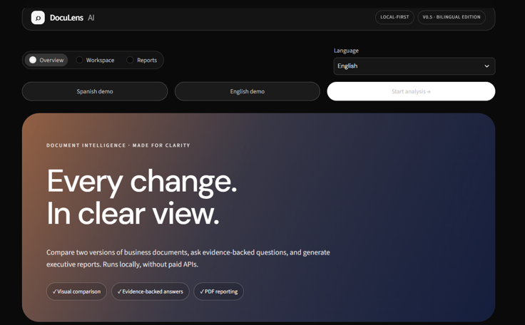
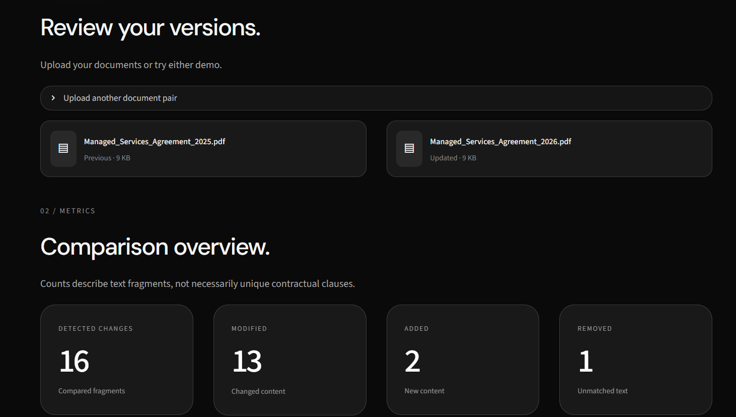
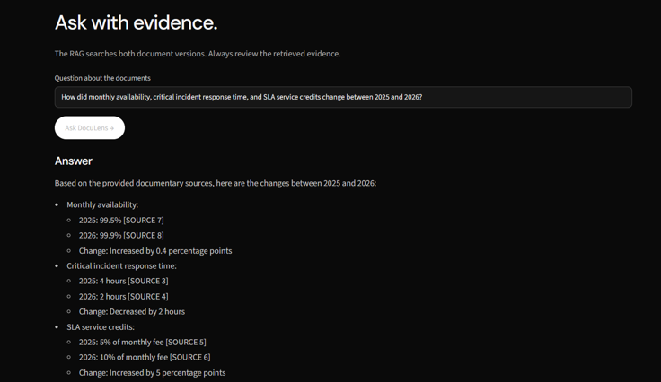
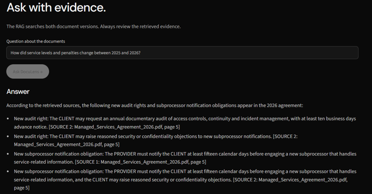
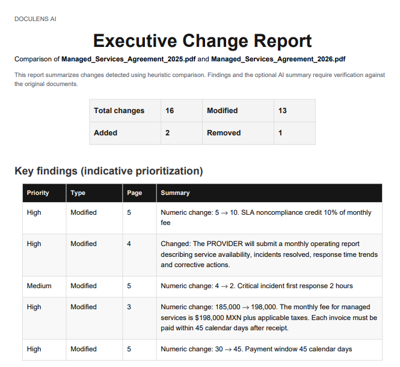
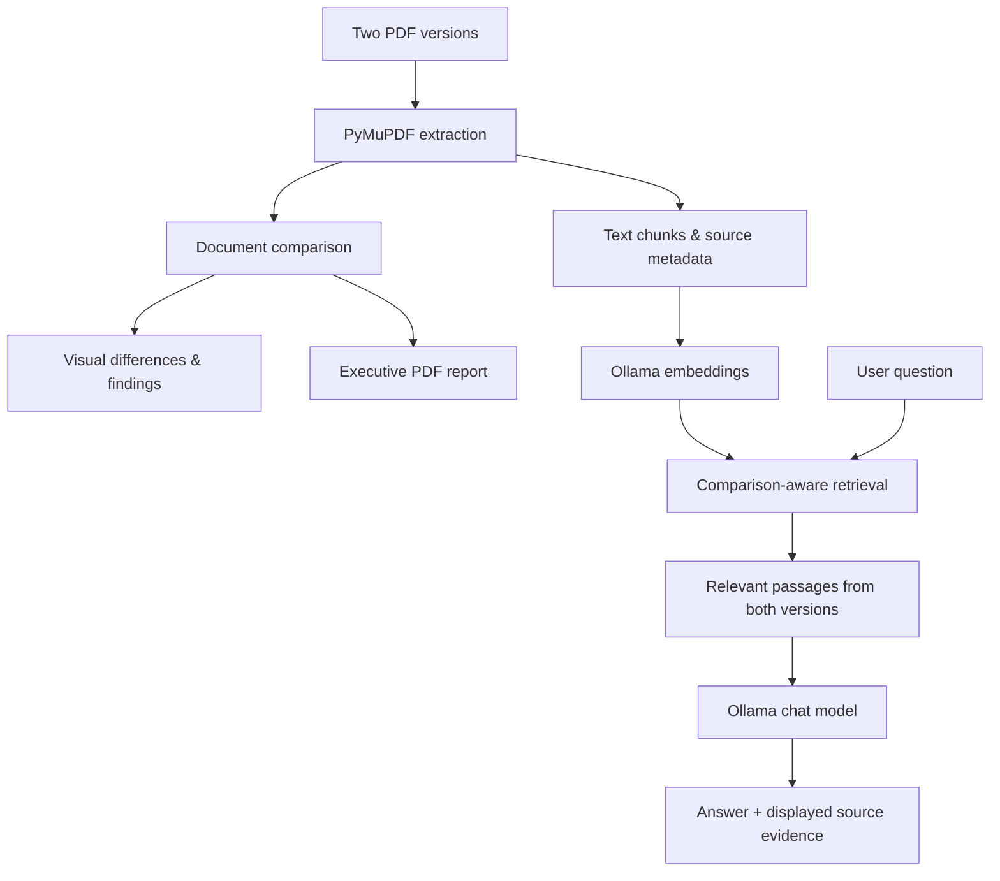

<div align="center">
  

  # DocuLens AI

  **Every change, in clear view.**

  A bilingual, local-first document intelligence prototype that compares PDF versions, answers evidence-grounded questions, and generates executive reports — powered by Ollama.

  **Python · Streamlit · Ollama · RAG · PyMuPDF · ReportLab**

  [Overview](#overview) · [Features](#features) · [Getting started](#getting-started) · [Architecture](#architecture) · [Limitations](#limitations)
</div>

---

## Product preview



## Overview

DocuLens AI helps reviewers explore differences between two versions of business documents. Upload a pair of selectable-text PDFs, examine highlighted modifications, ask questions based on the original passages, and export a structured comparison report.

The prototype runs locally: document parsing, comparison, and PDF export do not require a remote service. Question answering and AI-written summaries use **Ollama** running on your machine. No paid API key is required.

Built as an **AI engineering portfolio project**, not a production legal-review platform. The included agreements are fictional examples.

## Features

### 01 · Visual document comparison

Compare two PDF versions in a side-by-side workspace, inspect additions, deletions, and modifications, and jump to the page references for detected changes.



### 02 · Evidence-grounded question answering

Ask questions about the documents using an on-device language model. DocuLens retrieves relevant source excerpts from both versions and displays the supporting evidence for inspection.





### 03 · Executive reporting

Review prioritized findings, request an AI-generated summary, and export a PDF containing a comparison overview and detailed changes.



### 04 · English and Spanish

DocuLens supports **English and Spanish**, with **automatic document-language detection** or manual selection. The interface, AI responses, summaries, and report headings follow the selected language. Original source excerpts are kept in their original language to preserve evidence. Language adherence by the model is best-effort and should be checked.

## Technology stack

| Layer | Technology | Purpose |
| --- | --- | --- |
| Application UI | Streamlit + custom CSS | Three-view document workflow |
| Document processing | PyMuPDF | Extract PDF text with page references |
| Comparison | Python, `difflib` | Heuristic text alignment and change highlighting |
| Embeddings | Ollama + `nomic-embed-text` | Local semantic retrieval |
| Language model | Ollama + `llama3.2:3b` | Evidence-based answers and summaries |
| Numerical operations | NumPy | Embedding similarity calculations |
| Reports | ReportLab | Export structured PDF reports |
| Testing | pytest | Automated checks of core and bilingual behavior |

## Architecture



*The comparison is heuristic; source display supports human verification but is not an automatic proof that every AI-generated claim is correct.*

## Getting started

### Prerequisites

- Windows, macOS, or Linux with Python 3.10+ and pip (tested during development on Windows/Python 3.13)
- [Ollama](https://ollama.com/download) installed and running
- Enough memory for the locally selected models

### 1. Clone and install

```powershell
git clone https://github.com/YOUR_USERNAME/doculens-ai.git
cd doculens-ai
py -m venv .venv
.\.venv\Scripts\python.exe -m pip install -r requirements.txt
```

On macOS/Linux, activate your virtual environment with `source .venv/bin/activate`, then use `python` in place of `.\.venv\Scripts\python.exe`.

### 2. Download Ollama models

```powershell
ollama pull llama3.2:3b
ollama pull nomic-embed-text
```

Ollama should be available at `http://127.0.0.1:11434`. Model names can be changed in the sidebar if compatible models are installed.

### 3. Launch the application

```powershell
.\.venv\Scripts\python.exe -m streamlit run app.py
```

Open **http://localhost:8501** in your browser.

## Try the included demos

Select **Load Spanish demo** or **Load English demo** in the app. The repository includes exactly two *pairs* of fictional agreements, one in each language.

| Language | Earlier version | Updated version |
| --- | --- | --- |
| English | `Managed_Services_Agreement_2025.pdf` | `Managed_Services_Agreement_2026.pdf` |
| Spanish | `Acuerdo_Servicios_Gestionados_2025.pdf` | `Acuerdo_Servicios_Gestionados_2026.pdf` |

**English example**

> How did monthly availability, critical incident response time, and SLA service credits change between 2025 and 2026?

**Spanish example**

> ¿Qué derechos de auditoría y qué obligaciones sobre subencargados aparecen en el contrato de 2026?

For the sample agreements, you can check changes such as availability **99.5% → 99.9%**, critical response **4 → 2 hours**, and SLA service credits **5% → 10%**. Always inspect the original passages before relying on the answer.

## Testing

Install the test runner in your project environment and run:

```powershell
.\.venv\Scripts\python.exe -m pip install pytest
.\.venv\Scripts\python.exe -m pytest -q
```

The current project version passed **11 automated tests** during development, covering core comparison, bilingual behavior, demo files, report generation, and mocked model requests. These tests **do not** establish legal accuracy or guarantee the quality of every live Ollama response.

## Design

The interface is based on the included `DESIGN.md` design direction: matte-black surfaces, translucent panels, restrained typography, pill controls, and a warm-to-cool hero gradient. The product is intentionally document-first rather than chatbot-first.

## Limitations and scope

- **Prototype, not legal advice:** changes and priorities require human review.
- **Text PDFs only:** scanned/image-only PDFs are not supported without OCR.
- **Heuristic comparison:** a single substantive edit may appear in multiple matched fragments, and some edits may be missed.
- **Generative uncertainty:** Ollama may omit findings, misinterpret clauses, or cite evidence imperfectly. Check the retrieved excerpts.
- **Local-first, not enterprise-hardened:** no production authentication, permissions, compliance certification, or cloud deployment is claimed.
- **Synthetic examples:** all sample contract data is fictional and provided for demonstration.

## Project status

**v0.5 — Bilingual Dimension Edition** · Portfolio prototype

---

<div align="center">
  Built to explore practical, transparent retrieval-augmented generation for business document workflows.
</div>
